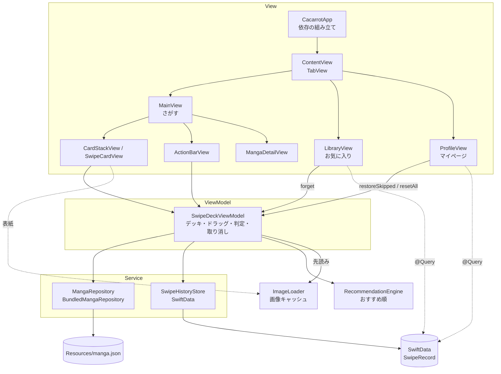
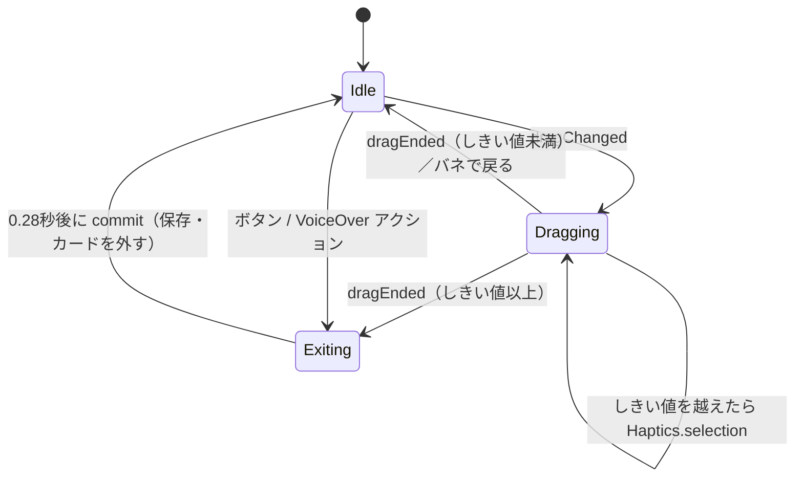

# アーキテクチャ設計書

## 1. 全体像

Cacarrot は、漫画のカードを左右上にスワイプして好みの作品を見つけるアプリです。構成は SwiftUI と MVVM です。

- **View**：表示と入力だけを担当します。
- **ViewModel**：デッキの状態とスワイプのロジックを持ちます。
- **Service**：データの取得と保存を担当します。



### 依存の組み立て

依存は [CacarrotApp.swift](../Cacarrot/CacarrotApp.swift) でまとめて組み立てます。

1. `ModelContainer(for: SwipeRecord.self)` を作ります。開けなかった場合は、メモリ上のストアで起動します。
2. `SwipeDeckViewModel(repository: BundledMangaRepository(), store: SwipeHistoryStore(context: container.mainContext))` を `@State` で 1 つだけ持ちます。
3. その ViewModel を `.environment(deck)` で全画面に渡し、`.modelContainer(container)` で SwiftData を渡します。
4. `AppDelegate` で `FirebaseApp.configure()` を呼びます。

### 起動モード

- 起動引数 `-uiTesting` が付いているときは（`LaunchMode.isUITesting`）、UI テスト用に次の構成で起動します。
  - メモリ上の SwiftData、専用の UserDefaults（`.defaultAppStorage` で `@AppStorage` にも適用）、`SampleMangaRepository`、おすすめ順オフ
  - Firebase は初期化せず、利用イベントも送らない
- 起動時に、保存しているお気に入りの作品情報を最新のデータで更新します（`SwipeHistoryStoring.refreshSnapshots`）。

### 読み書きの分担

- **書き込み**：デッキ操作による書き込みは、すべて `SwipeDeckViewModel` から `SwipeHistoryStore` を通して行います。
- **読み取り**：お気に入り一覧と統計は、View が `@Query` で SwiftData を直接読みます。

## 2. レイヤーごとの責務

### Models（`Cacarrot/Models`）

| 型 | 役割 |
| --- | --- |
| `Manga` | カード 1 枚分の作品データ（id・タイトル・作者・ジャンル・あらすじ・`imageName?`・`imageURL?`・`publisher?`・`itemURL?`）。値型でイミュータブル、`Codable` |
| `SwipeAction` | ユーザーの判定。`like` / `superLike` / `nope` の 3 つ。スタンプの文字・表示名・SF Symbols・色・画面外へ飛ぶ方向（`exitOffset(in:)`）を持つ |
| `SwipeRecord` | 判定の履歴。SwiftData の `@Model`。`mangaID` はユニーク。一覧表示用に作品情報のコピーを持ち、`manga` で `Manga` に戻せる。`likedPredicate` は、いいね・スーパーいいねだけを取り出す `@Query` 用の条件 |

### Services（`Cacarrot/Services`）

| 型 | 役割 |
| --- | --- |
| `MangaRepository` | 作品データの取得元を表すプロトコル（`fetchAll() async throws -> [Manga]`）。API や Firestore に差し替えられるようにしている |
| `BundledMangaRepository` | アプリに同梱した `manga.json` をバックグラウンドで読み込み、デコードしてシャッフルする |
| `SampleMangaRepository` | プレビュー用のサンプル 6 件。表紙はローカル画像 |
| `SwipeHistoryStoring` | 履歴の読み書きのプロトコル。ViewModel はこれだけに依存し、テストでは失敗する偽物に差し替える |
| `SwipeHistoryStore` | `SwipeHistoryStoring` の SwiftData 実装。`SwipeRecord` の追加・更新・削除。ViewModel から SwiftData の細かい処理を隠す。`history()` でおすすめ計算用、`recentHistory(limit:)` で取り消し用の履歴を返す。書き込みは保存に失敗すると変更を取り消して（rollback）エラーを投げる |
| `ImageLoader` | 表紙画像の取得とキャッシュ。メモリ（NSCache、デコード済み）とディスク（専用の URLCache、300MB、`Caches/CoverImages`）の2段。同じURLへの同時リクエストは1本にまとめる。`prefetch(_:)` で先読み |
| `AnalyticsService` | 利用イベント（`AnalyticsEvent`）の定義と記録先。`AnalyticsLogging` プロトコルで差し替え可能。アプリは `FirebaseAnalyticsLogger`、テストとプレビューは `NoopAnalyticsLogger` / 偽物を使う。作品名や ID は送らない |
| `RecommendationEngine` | 判定履歴からジャンルの好み度を計算し、デッキを並べ替える（詳しくは「4. おすすめ順の仕組み」） |

### ViewModels（`Cacarrot/ViewModels`）

`SwipeDeckViewModel`（`@Observable`、`@MainActor`）がアプリの中心です。

| 区分 | メンバー | 内容 |
| --- | --- | --- |
| 状態 | `cards` | 未判定のカード。先頭が一番上 |
| | `dragOffset` | 一番上のカードのドラッグ量 |
| | `cardSize` | カードの表示サイズ。ボタン操作で飛ばすときの距離に使う |
| | `loadState` | `idle` / `loading` / `loaded` / `failed(String)` |
| | `exitingAction` | 画面外へ飛ばしている最中の判定。`nil` 以外のあいだは操作を受け付けない |
| 読み込み | `loadIfNeeded()` / `reload()` | 全作品を取得し、判定済みの ID を除いてデッキを作る |
| ドラッグ | `dragChanged(_:)` / `dragEnded(translation:predicted:)` | しきい値の判定と触覚フィードバック |
| 判定 | `swipe(_:)` | カードを画面外へ飛ばし、アニメーションが終わったら `commit` で保存してデッキから外す |
| 取り消し | `undo()` | 直前の判定を取り消してカードを一番上に戻す。デッキを作るとき、保存済みの判定の新しい順から最大20件を取り消し履歴として復元するので、再起動後も取り消せる |
| 動き | `reduceMotion` | 「視差効果を減らす」設定（`MainView` が環境値から渡す）。オンなら `swipe` はアニメーションせずに即確定する |
| エラー | `errorMessage` | 保存に失敗したときのメッセージ。`ContentView` がアラートで表示する。判定の保存に失敗したカードは元の位置に戻す |
| 管理 | `restoreSkipped()` / `resetAll()` / `forget(mangaID:)` / `changeAction(mangaID:to:)` | スキップを戻す、すべて消す、お気に入りから外してデッキの最後に戻す、判定を変える（日時は保つ） |
| 表示 | `stampOpacity(for:)` | GOOD / NOPE / SUPER スタンプの濃さ |
| おすすめ | `isRecommendationEnabled` | おすすめ順のオン・オフ。UserDefaults に保存。切り替えると、見えている上の3枚以外を並べ直す |
| 先読み | （内部）`prefetchUpcoming()` | デッキを作ったとき・判定のたびに、上から6枚の表紙を先読みする |
| 絞り込み | `selectedGenres` / `availableGenres` / `setGenreFilter(_:)` | ジャンルでデッキを絞り込む（いずれかのジャンルを含む作品）。選択は UserDefaults に保存。変更してもデッキを作り直すだけで、取り消し履歴は残す |
| 件数 | `remainingCount` / `filteredTotalCount` / `checkedCount` | 残り（絞り込み後）、絞り込み条件に合う全作品数、判定済みの数（絞り込みに関係なく全作品のうち） |

### Utilities（`Cacarrot/Utilities`）

| 型 | 役割 |
| --- | --- |
| `Theme` | アプリ全体の色（like・nope・superLike・undo・accent）とカードの角丸 |
| `Haptics` | 触覚フィードバック（impact・selection・success） |

## 3. スワイプ判定の仕組み



**しきい値**

| 判定 | 条件 |
| --- | --- |
| like | 横方向 +110pt |
| nope | 横方向 −110pt |
| superLike | 上方向 140pt、かつ縦の移動が横より大きい |

**判定のタイミング**

- 指を離した位置で判定します。
- 届かなかった場合は、勢いを含めた予測位置（`predictedEndTranslation`）でも判定します。そのときのしきい値は 2 倍です。

**アニメーション**

- `withAnimation(_:completionCriteria:completion:)` を使い、カードが画面外へ飛び終わってから保存してデッキから外します。
- 以前は、飛ばしたカードが画面外に残ったままになり、デッキが壊れる不具合がありました。この順番はそれを防ぐためのものです。

**重なりの表示**

- 描画するのは上から 3 枚だけです。
- 一番上のカードを動かすほど、後ろのカードが少しずつ大きく前に出てきます（`CardStackView.dragProgress`）。

## 4. おすすめ順の仕組み

`RecommendationEngine` が、判定履歴からデッキの並び順を決めます。

1. **ジャンルの好み度**：判定ごとに、その作品の各ジャンルへ次の値を加算し、最大の絶対値が 1 になるよう正規化します。

| 判定 | 加算 |
| --- | --- |
| いいね | +1 |
| スーパーいいね | +2 |
| スキップ | −0.5 |

2. **作品のスコア**：作品のジャンルの好み度の平均に、0〜0.6 のランダムな揺らぎを足します。
3. **並べ替え**：スコアの高い順に並べます。ただし、**4枚に1枚**は、スコアの下半分からランダムに選んだ作品を入れます（新しい好みに出会えるように）。
4. **並べ直すタイミング**
   - デッキを作ったとき（起動時、スキップを戻したとき、リセットしたとき）
   - 10枚判定するごと
   - おすすめ順を切り替えたとき
   - 見えている上の3枚は入れ替えません。
5. 履歴がないときは、元のランダムな順番のままです。

## 5. フォルダ構成

```
Cacarrot/
├── Cacarrot.xcodeproj
├── Cacarrot/                 アプリのソース
│   ├── CacarrotApp.swift     エントリポイント・依存の組み立て
│   ├── ContentView.swift     タブ
│   ├── Models/
│   ├── Services/
│   ├── ViewModels/
│   ├── Views/
│   │   ├── Main/             さがす（カード・ボタン・ヘッダー・ジャンル絞り込み）
│   │   ├── List/             お気に入り
│   │   ├── Profile/          マイページ
│   │   └── Shared/           表紙・ジャンルタグ・詳細シート・使い方・プレビュー
│   ├── Utilities/
│   ├── Resources/manga.json  同梱データ（自動生成）
│   └── Assets.xcassets
├── CacarrotTests/            アプリの単体テスト（XCTest）
├── MangaInfoFetcher/         データ取得と変換の Python スクリプト
├── Design/                   ロゴやアイコンの元画像
└── docs/                     このドキュメント
```
