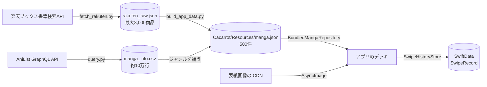

# データ設計書

## 1. データの流れ



- 作品データはアプリに同梱した JSON です。起動中にネットワークから作品情報を取ることはありません。
- 表紙画像だけは、`imageURL` から毎回ネットワークで読み込みます。
- データ源は2つあります。`build_app_data.py --source` で選びます。

| データ源 | 状態 | 内容 |
| --- | --- | --- |
| `rakuten`（これから主に使う） | スクリプトは完成。楽天のサーバ停止中のため、実データでは未検証 | 日本語のあらすじ・作者・表紙・商品リンク。ジャンルは AniList から補う |
| `anilist`（現在の manga.json） | 使用中 | 英語のあらすじ、ローマ字の作者名 |

## 2. 取得（楽天）：MangaInfoFetcher/fetch_rakuten.py

- `MangaInfoFetcher/.env` から `RAKUTEN_APP_ID` / `RAKUTEN_ACCESS_KEY` / `RAKUTEN_AFFILIATE_ID`（任意）/ `RAKUTEN_REFERER` を読みます。`.env` は Git の管理外です。
- 呼び出し先は `https://openapi.rakuten.co.jp/services/api/BooksBook/Search/20170404`（2026年の新仕様）です。
- コミック（`booksGenreId=001001`）を売れ筋順（`sort=sales`）に、1ページ30件・最大100ページ取得し、`rakuten_raw.json` に保存します（Git の管理外）。
- 楽天の制限（1秒1回）に合わせて、1.2秒ずつ待ちます。
- 各商品に、売れ筋順の順位 `_rank` を付けて保存します。
- `--check` を付けると1件だけ取得し、接続を確認します。エラーのときは、原因の候補（IP未登録、Referer不一致など）を表示します。

## 2.1 取得（AniList）：MangaInfoFetcher/query.py

**取得の仕方**
- AniList の GraphQL API（`https://graphql.anilist.co`）から、`type: MANGA` の作品を 1 ページ 50 件ずつ取得し、`manga_info.csv` に追記します。
- レート制限を避けるため、1 ページごとに 40 秒待ちます。
- 1ページ書き込むたびに、次に取得するページを `fetch_state.json` に保存します。次回はそこから再開します。
  - 状態ファイルがなく CSV がある場合は、以前の再開ページ（1995）から始めます。`--start-page` で指定もできます。
- urllib の既定の User-Agent は Cloudflare に拒否されるため、`CacarrotDataFetcher/1.0` を付けて送ります。

**CSV の列**

| 列 | 内容 |
| --- | --- |
| ID | AniList の作品 ID |
| Romaji Title / English Title / Native Title | タイトル（ローマ字・英語・原語） |
| Cover Image | 表紙画像の URL（medium） |
| Genres | カンマ区切りの英語ジャンル |
| Average Score | 平均スコア（0〜100） |
| Description | あらすじ（英語、HTML を含む） |
| Start Date | 連載開始日（`YYYY-MM-DD`） |
| Staff Names | スタッフ名。`; ` 区切り |

## 3. 変換：MangaInfoFetcher/build_app_data.py

```bash
cd MangaInfoFetcher && python3 build_app_data.py --limit 500
```

`--source` を省略すると、`rakuten_raw.json` があれば `rakuten`、なければ `anilist` で変換します。

### 3.1 rakuten モード

楽天は巻ごとの商品を返すため、作品ごとにまとめます。

1. 次の商品を除きます。
   - タイトルに「特装版」「限定版」「画集」「ファンブック」「セット」などを含むもの
   - 表紙がないもの（`noimage`）
2. タイトルから作品名と巻数を取り出します（`series_title`）。
   - 例：「呪術廻戦 1（ジャンプコミックス）」→ 作品名「呪術廻戦」、1巻
3. 「作品名＋作者」が同じ商品を1作品にまとめます。代表には、あらすじがある商品のうち一番若い巻を使います。
4. 並び順は、その作品の中で一番売れている巻の順位です。
5. 値を整えます。

| 項目 | 内容 |
| --- | --- |
| id | ISBN（13桁）。ない場合は順位から仮のIDを振る |
| 作者 | 1人目の名前。日本語名は空白を詰める（「尾田 栄一郎」→「尾田栄一郎」） |
| あらすじ | 商品説明から HTML タグ、【特典】【限定】などの括弧書き、※★■で始まる行を取り除く |
| ジャンル | 楽天の区分（少年・少女・青年・女性）を先頭に置き、AniList の原題と一致した作品のジャンル（アクションなど）を続ける。AniList で Hentai/Ecchi の作品は除く |
| 表紙 | `?_ex=200x200` を `_ex=600x600` に置き換える（大きいサイズが取れるかは要確認） |
| publisher / itemURL | 出版社。アフィリエイトURL（なければ商品URL） |

楽天の区分コード（`001001001`＝少年 など）と表紙の拡大は推測で書いています。実データで確認が必要です。

### 3.2 anilist モード（旧方式）

**作品を選ぶ条件**（処理の順）

1. ID かスコアが数値でない行と、すでに出てきた ID の行を飛ばします（CSV には重複があるため）。
2. スコアが `--min-score`（初期値 75）未満の作品を除きます。
3. 日本の作品だけを残します。CSV に国の情報がないため、Native Title の文字で判定します。
   - かなを含む場合は残します。
   - 漢字だけの場合は、Shift_JIS で表せるものだけ残します。
4. 表紙とあらすじの両方がある作品だけを残します。
5. ジャンルが Hentai または Ecchi の作品を除きます（App Store の審査対策）。
6. スコアの高い順に並べ、上位 `--limit` 件（初期値 500）を出力します。

**値の整え方**

| 項目 | 内容 |
| --- | --- |
| あらすじ | `<i>Note:` 以降を削除し、HTML タグ、`(Source: …)` の出典表記、余分な空白と改行を取り除く |
| ジャンル | `GENRE_JA` で日本語に置き換える（例：Action → アクション）。表にないものは英語のまま |
| 作者 | Staff Names の 1 人目 |
| 表紙 URL | `/cover/medium/` を `/cover/large/` に置き換える |

## 4. manga.json の形式

`Manga` 型（`Codable`）の配列です。

```json
[
 {
  "id": 30002,
  "title": "ベルセルク",
  "author": "Kentarou Miura",
  "genres": ["アクション", "冒険", "ドラマ", "ファンタジー", "ホラー", "心理"],
  "summary": "His name is Guts, the Black Swordsman, ...",
  "imageURL": "https://s4.anilist.co/file/anilistcdn/media/manga/cover/large/....jpg"
 }
]
```

- 楽天のデータでは、`"publisher": "集英社"` と `"itemURL": "https://..."` も入ります。どちらも省略できます。
- `imageName` は、ローカル画像を使う場合だけ指定します（プレビュー用のサンプルが使っています）。
- 表紙は、ローカル画像、リモート画像、プレースホルダーの順に表示を試します（`MangaCoverView`）。

## 5. 永続化：SwiftData の SwipeRecord

| プロパティ | 型 | 内容 |
| --- | --- | --- |
| `mangaID` | Int（ユニーク） | 作品 ID |
| `title` / `author` / `genres` / `summary` | String / [String] | 判定したときの作品情報のコピー |
| `imageName` / `imageURLString` | String? | 表紙 |
| `publisher` / `itemURLString` | String? | 出版社、商品ページ（2026-11-16 に追加。オプショナルなので既存データは自動で移行される） |
| `actionRawValue` | String | `like` / `superLike` / `nope` |
| `createdAt` | Date | 判定した日時。同じ作品を判定し直すと更新される |

- **作品情報をコピーする理由**：お気に入り一覧は、`manga.json` を読まずに SwiftData だけで表示できるようにしています。
- **作品 ID の扱い**：1 作品につき 1 件です。同じ作品をもう一度判定すると、判定と日時を上書きします。
- **デッキの作り方**：起動時に `swipedIDs()` で判定済みの ID を集め、全作品からそれを除いた残りがデッキになります。
- **取り消し履歴**：別には保存せず、`createdAt` の新しい順に最大20件を復元します。
- **データ源を変えたとき**：ID が変わった履歴は、起動時にタイトルが同じ作品へ付け替えます（`relinkOrphans`）。付け替えられなかった履歴も消さずに残るので、お気に入りには表示され続けます。
