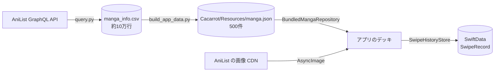

# データ設計書

## 1. データの流れ



- 作品データはアプリに同梱した JSON です。起動中にネットワークから作品情報を取ることはありません。
- 表紙画像だけは、`imageURL` から毎回ネットワークで読み込みます。

## 2. 取得：MangaInfoFetcher/query.py

**取得の仕方**
- AniList の GraphQL API（`https://graphql.anilist.co`）から、`type: MANGA` の作品を 1 ページ 50 件ずつ取得し、`manga_info.csv` に追記します。
- レート制限を避けるため、1 ページごとに 40 秒待ちます。
- 再開するページは、スクリプト内の `start_page` を書き換えて指定します（現在は 1995）。

**CSV の列**

| 列 | 内容 |
| --- | --- |
| ID | AniList の作品 ID |
| Romaji Title / English Title / Native Title | タイトル（ローマ字・英語・原語） |
| Cover Image | 表紙画像の URL（medium） |
| Genres | カンマ区切りの英語ジャンル |
| Average Score | 平均スコア（0〜100） |
| Description | あらすじ（英語、HTML を含む） |
| Start Date | 連載開始日（`YYYY-MM-DD`） |
| Staff Names | スタッフ名。`; ` 区切り |

## 3. 変換：MangaInfoFetcher/build_app_data.py

```bash
cd MangaInfoFetcher && python3 build_app_data.py --limit 500 --min-score 75
```

**作品を選ぶ条件**（処理の順）

1. ID かスコアが数値でない行と、すでに出てきた ID の行を飛ばします（CSV には重複があるため）。
2. スコアが `--min-score`（初期値 75）未満の作品を除きます。
3. 日本の作品だけを残します。CSV に国の情報がないため、Native Title の文字で判定します。
   - かなを含む場合は残します。
   - 漢字だけの場合は、Shift_JIS で表せるものだけ残します。
4. 表紙とあらすじの両方がある作品だけを残します。
5. ジャンルが Hentai または Ecchi の作品を除きます（App Store の審査対策）。
6. スコアの高い順に並べ、上位 `--limit` 件（初期値 500）を出力します。

**値の整え方**

| 項目 | 内容 |
| --- | --- |
| あらすじ | `<i>Note:` 以降を削除し、HTML タグ、`(Source: …)` の出典表記、余分な空白と改行を取り除く |
| ジャンル | `GENRE_JA` で日本語に置き換える（例：Action → アクション）。表にないものは英語のまま |
| 作者 | Staff Names の 1 人目 |
| 表紙 URL | `/cover/medium/` を `/cover/large/` に置き換える |

## 4. manga.json の形式

`Manga` 型（`Codable`）の配列です。

```json
[
 {
  "id": 30002,
  "title": "ベルセルク",
  "author": "Kentarou Miura",
  "genres": ["アクション", "冒険", "ドラマ", "ファンタジー", "ホラー", "心理"],
  "summary": "His name is Guts, the Black Swordsman, ...",
  "imageURL": "https://s4.anilist.co/file/anilistcdn/media/manga/cover/large/....jpg"
 }
]
```

- `imageName` は、ローカル画像を使う場合だけ指定します（プレビュー用のサンプルが使っています）。
- 表紙は、ローカル画像、リモート画像、プレースホルダーの順に表示を試します（`MangaCoverView`）。

## 5. 永続化：SwiftData の SwipeRecord

| プロパティ | 型 | 内容 |
| --- | --- | --- |
| `mangaID` | Int（ユニーク） | 作品 ID |
| `title` / `author` / `genres` / `summary` | String / [String] | 判定したときの作品情報のコピー |
| `imageName` / `imageURLString` | String? | 表紙 |
| `actionRawValue` | String | `like` / `superLike` / `nope` |
| `createdAt` | Date | 判定した日時。同じ作品を判定し直すと更新される |

- **作品情報をコピーする理由**：お気に入り一覧は、`manga.json` を読まずに SwiftData だけで表示できるようにしています。
- **作品 ID の扱い**：1 作品につき 1 件です。同じ作品をもう一度判定すると、判定と日時を上書きします。
- **デッキの作り方**：起動時に `swipedIDs()` で判定済みの ID を集め、全作品からそれを除いた残りがデッキになります。
- **取り消し履歴**：保存しません。取り消しできるのは、アプリを起動しているあいだだけです。
