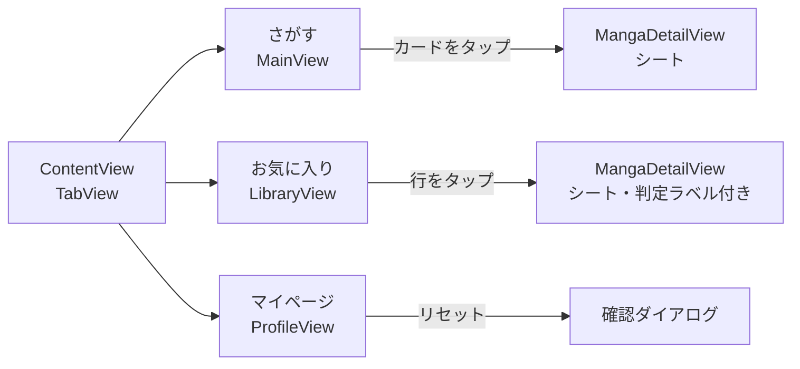

# 画面設計書

## 1. 画面構成

| タブ | アイコン | バッジ |
| --- | --- | --- |
| さがす | `rectangle.stack.fill` | なし |
| お気に入り | `heart.fill` | いいねとスーパーいいねの合計 |
| マイページ | `person.fill` | なし |

## 2. さがす（MainView）

**画面の構成**（上から順に）

1. **HeaderView**：左に絞り込みボタン（絞り込み中はオレンジで選択数を表示）、中央にロゴ、右に「残り / 全体」の枚数（絞り込み中は条件に合う作品数）。
2. **カード領域**：読み込みの状態に応じて、下の表のどれかを表示します。
3. **ActionBarView**：取り消す（黄）、スキップ（赤・大）、スーパーいいね（青）、いいね（緑・大）の 4 ボタン。

| 状態 | 表示 |
| --- | --- |
| 読み込み中 | `ProgressView("読み込み中…")` |
| 失敗 | エラー内容と「再試行」ボタン |
| カードあり | `CardStackView`（上から 3 枚を重ねて描画） |
| カードなし | `EmptyDeckView`。「スキップした作品をもう一度見る」ボタンと、取り消せる場合は「直前の判定を取り消す」ボタン |
| カードなし（絞り込み中） | 「この条件の作品はすべてチェックしました」と選択中のジャンル、「絞り込みを解除する」ボタン |
| 初回起動 | 使い方（`SwipeGuideView`）を暗い背景の上に重ねて表示。「はじめる」か背景のタップで閉じ、以降は表示しない（`@AppStorage("hasSeenSwipeGuide")`） |

### カード（SwipeCardView）

**表示内容**
- 表紙を全面に表示し、下側を黒のグラデーションで暗くします。
- その上にタイトル（最大 2 行）、作者、ジャンルタグ、あらすじ（3 行）、「タップで詳細」を重ねます。

**スタンプ**
- ドラッグの方向に応じて、GOOD（左上）、NOPE（右上）、SUPER（下寄り）のスタンプが徐々に濃くなります。
- 操作は下の表のとおりです。しきい値の詳細は [architecture.md](architecture.md#3-スワイプ判定の仕組み) を参照してください。

| 操作 | 結果 |
| --- | --- |
| 右スワイプ / いいねボタン | いいね |
| 左スワイプ / スキップボタン | スキップ |
| 上スワイプ / スーパーいいねボタン | スーパーいいね（成功の触覚フィードバック） |
| タップ | 詳細シートを開く（シート下部のボタンからも判定できる） |
| 取り消すボタン | 直前の判定を戻す（最大20件まで。アプリを再起動しても戻せる） |
| VoiceOver | カスタムアクション「いいね」「スキップ」「スーパーいいね」 |

## 3. お気に入り（LibraryView）

**一覧**
- いいねとスーパーいいねした作品を、新しい順に表示します。
- 各行には、表紙のサムネイル、タイトル、作者、ジャンル、判定アイコンを表示します。

**操作**
- **絞り込み**：上部のセグメントで「すべて / スーパー / いいね」を切り替えます。
- **検索**：タイトル、作者、ジャンルで検索できます（`.searchable`）。
- **削除**：行を左にスワイプして削除すると、履歴から消えます。その作品はデッキの最後に戻ります（`forget(mangaID:)`）。
- **判定の変更**：行を右にスワイプするか長押しすると、いいね ⇄ スーパーいいね を切り替えられます。判定した日時は変わらないので、並び順は保たれます。
- **並び順**：右上のメニューで「新しい順・古い順・タイトル順」を選べます。選択は保存されます。
- **共有**：右上の共有ボタンで、表示中の一覧を「★ タイトル（作者）」「♥ タイトル（作者）」の形の文章で共有できます。

### スキップした作品（SkippedListView）

- マイページから開きます。スキップした作品を新しい順に表示します。
- 行を左にスワイプすると「デッキに戻す」（デッキの最後に戻る）、右にスワイプすると「いいねにする」。
- 右上の「すべて戻す」で、スキップした作品をまとめてデッキに戻します。

**その他の表示**
- 1 件もないときは、「まだお気に入りがありません」と表示します。
- 検索結果がないときは、`ContentUnavailableView.search` を表示します。

## 4. マイページ（ProfileView）

| セクション | 内容 |
| --- | --- |
| スワイプ統計 | いいね、スーパーいいね、スキップの件数タイル。「チェック済み n / 全体」の進捗バー |
| 好きなジャンル | いいねした作品のジャンルの上位 5 件を横棒で表示。スーパーいいねは 2 倍で数える |
| 表示 | 「おすすめ順で表示」トグル（初期値オン）。オフにするとランダムな順番。「触覚フィードバック」トグル（初期値オン）。「使い方を見る」で使い方を再表示（ボタンは「閉じる」） |
| リマインダー | 「毎日のリマインダー」トグル（初期値オフ）。オンにすると通知の許可を求め、「通知する時刻」（初期値 20:00）に毎日ローカル通知を出す。許可されなければオフに戻し、設定アプリを開くボタン付きのアラートを出す。起動時にオンなら登録し直す |
| 操作 | 「スキップした作品（件数）」から一覧（`SkippedListView`）へ移動。「すべての履歴をリセット」。リセットは確認ダイアログを出してから実行し、取り消せない |

## 5. 詳細シート（MangaDetailView）

- 左上の共有ボタンで、「『タイトル』（作者）をCacarrotで見つけました」という文と、商品ページのURL（楽天データのみ）を共有できます。
- 表紙（高さ 360）、タイトル、作者、出版社（楽天データのみ）、判定ラベル（お気に入りから開いた場合のみ）、ジャンルタグ、あらすじの全文を表示します。
- 楽天のデータのときは、下に「楽天ブックスで見る」ボタンを表示します。
- 「さがす」から開いた場合は、下にスキップ・スーパーいいね・いいねのボタンを表示します。押すとシートを閉じて、そのカードを判定します。お気に入りから開いた場合は表示しません。
- あらすじの下に「似ている作品」を最大8件、横スクロールで表示します。ジャンルの重なり（Jaccard 係数）に、作者が同じなら 0.5 を足した近さの順です。同じ近さなら、まだ判定していない作品を先にします。判定済みの作品には表紙の右上にチェックを付けます。
- 似ている作品をタップすると、同じシートの中で詳細に進みます（戻るボタンで戻る）。進んだ先では判定ボタンを出しません（デッキの一番上のカードとは別の作品のため）。
- 右上の「閉じる」ボタンか、下へスワイプして閉じます。

## 6. ジャンルの絞り込み（GenreFilterView）

- 「さがす」の左上のボタンから、シート（半分または全画面）で開きます。
- ジャンルを作品数の多い順に並べ、複数選択できます。選んだジャンルの**いずれか**を含む作品がデッキに残ります。
- 「完了」で反映します。「すべて解除」で選択を外します。
- 選択はアプリを閉じても残ります。
- マイページの「チェック済み」の進捗は、絞り込みに関係なく全作品で数えます。

## 7. 表紙画像の表示（共通）

- 読み込み中は `ProgressView` を表示します。
- 読み込みに失敗したときは、本のアイコンと「再読み込み」ボタンを表示します。
- 一度表示した表紙はディスクに保存されるので、再起動後やオフラインでも表示できます。

## 8. エラー表示

- 履歴の保存に失敗したときは、どの画面にいても「保存できませんでした」のアラートを表示します。
- 判定の保存に失敗したカードは画面外へ飛ばず、元の位置に戻ります。

## 9. デザインルール

| 項目 | 値 |
| --- | --- |
| アクセントカラー | にんじんオレンジ（AccentColor、R0.976 / G0.478 / B0.122） |
| いいね | 緑（`Theme.like`） |
| スキップ | 赤（`Theme.nope`） |
| スーパーいいね | 青（`Theme.superLike`） |
| 取り消す | 黄（`Theme.undo`） |
| カードの角丸 | 20pt（`Theme.cardCornerRadius`） |
| 背景 | `systemGroupedBackground` |
| 押したときの動き | `PressableButtonStyle`（0.88 倍に縮む） |
| 画面の向き | iPhone は縦向きのみ。iPad はすべての向きに対応し、カードとヘッダーは最大 520pt の幅で中央に置く |
| ダークモード | すべての画面がシステムの色で切り替わる。ロゴはダークモード用の画像（にんじんの線画を明るくしたもの）に切り替わる |
| 視差効果を減らす | オンのときは、ドラッグ中にカードを傾けず、判定したカードを画面外へ飛ばさずにフェードで入れ替える |
| 文字サイズ | 詳細シート・一覧・マイページはシステムの設定どおりに拡大する。カードは xxLarge、ヘッダーは xLarge までに制限（大きさが決まっているため。全文は詳細シートで読める）。マイページの好きなジャンルは、アクセシビリティサイズではジャンル名を棒の上に置く |
