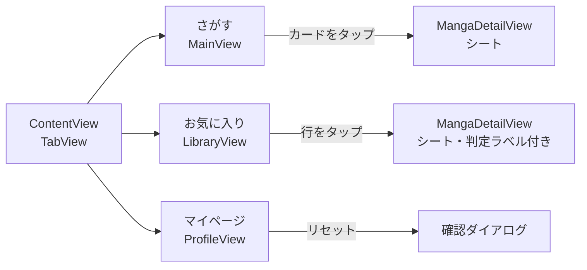

# 画面設計書

## 1. 画面構成

| タブ | アイコン | バッジ |
| --- | --- | --- |
| さがす | `rectangle.stack.fill` | なし |
| お気に入り | `heart.fill` | いいねとスーパーいいねの合計 |
| マイページ | `person.fill` | なし |

## 2. さがす（MainView）

**画面の構成**（上から順に）

1. **HeaderView**：中央にロゴ、右に「残り / 全体」の枚数。
2. **カード領域**：読み込みの状態に応じて、下の表のどれかを表示します。
3. **ActionBarView**：取り消す（黄）、スキップ（赤・大）、スーパーいいね（青）、いいね（緑・大）の 4 ボタン。

| 状態 | 表示 |
| --- | --- |
| 読み込み中 | `ProgressView("読み込み中…")` |
| 失敗 | エラー内容と「再試行」ボタン |
| カードあり | `CardStackView`（上から 3 枚を重ねて描画） |
| カードなし | `EmptyDeckView`。「スキップした作品をもう一度見る」ボタンと、取り消せる場合は「直前の判定を取り消す」ボタン |

### カード（SwipeCardView）

**表示内容**
- 表紙を全面に表示し、下側を黒のグラデーションで暗くします。
- その上にタイトル（最大 2 行）、作者、ジャンルタグ、あらすじ（3 行）、「タップで詳細」を重ねます。

**スタンプ**
- ドラッグの方向に応じて、GOOD（左上）、NOPE（右上）、SUPER（下寄り）のスタンプが徐々に濃くなります。
- 操作は下の表のとおりです。しきい値の詳細は [architecture.md](architecture.md#3-スワイプ判定の仕組み) を参照してください。

| 操作 | 結果 |
| --- | --- |
| 右スワイプ / いいねボタン | いいね |
| 左スワイプ / スキップボタン | スキップ |
| 上スワイプ / スーパーいいねボタン | スーパーいいね（成功の触覚フィードバック） |
| タップ | 詳細シートを開く |
| 取り消すボタン | 直前の判定を戻す（アプリを再起動すると戻せない） |
| VoiceOver | カスタムアクション「いいね」「スキップ」「スーパーいいね」 |

## 3. お気に入り（LibraryView）

**一覧**
- いいねとスーパーいいねした作品を、新しい順に表示します。
- 各行には、表紙のサムネイル、タイトル、作者、ジャンル、判定アイコンを表示します。

**操作**
- **絞り込み**：上部のセグメントで「すべて / スーパー / いいね」を切り替えます。
- **検索**：タイトル、作者、ジャンルで検索できます（`.searchable`）。
- **削除**：行を左にスワイプして削除すると、履歴から消えます。その作品はデッキの最後に戻ります（`forget(mangaID:)`）。

**その他の表示**
- 1 件もないときは、「まだお気に入りがありません」と表示します。
- 検索結果がないときは、`ContentUnavailableView.search` を表示します。

## 4. マイページ（ProfileView）

| セクション | 内容 |
| --- | --- |
| スワイプ統計 | いいね、スーパーいいね、スキップの件数タイル。「チェック済み n / 全体」の進捗バー |
| 好きなジャンル | いいねした作品のジャンルの上位 5 件を横棒で表示。スーパーいいねは 2 倍で数える |
| 表示 | 「おすすめ順で表示」トグル（初期値オン）。オフにするとランダムな順番 |
| 操作 | 「スキップした作品をデッキに戻す」と「すべての履歴をリセット」。リセットは確認ダイアログを出してから実行し、取り消せない |

## 5. 詳細シート（MangaDetailView）

- 表紙（高さ 360）、タイトル、作者、出版社（楽天データのみ）、判定ラベル（お気に入りから開いた場合のみ）、ジャンルタグ、あらすじの全文を表示します。
- 楽天のデータのときは、下に「楽天ブックスで見る」ボタンを表示します。
- 右上の「閉じる」ボタンか、下へスワイプして閉じます。

## 6. 表紙画像の表示（共通）

- 読み込み中は `ProgressView` を表示します。
- 読み込みに失敗したときは、本のアイコンと「再読み込み」ボタンを表示します。
- 一度表示した表紙はディスクに保存されるので、再起動後やオフラインでも表示できます。

## 7. デザインルール

| 項目 | 値 |
| --- | --- |
| アクセントカラー | にんじんオレンジ（AccentColor、R0.976 / G0.478 / B0.122） |
| いいね | 緑（`Theme.like`） |
| スキップ | 赤（`Theme.nope`） |
| スーパーいいね | 青（`Theme.superLike`） |
| 取り消す | 黄（`Theme.undo`） |
| カードの角丸 | 20pt（`Theme.cardCornerRadius`） |
| 背景 | `systemGroupedBackground` |
| 押したときの動き | `PressableButtonStyle`（0.88 倍に縮む） |
